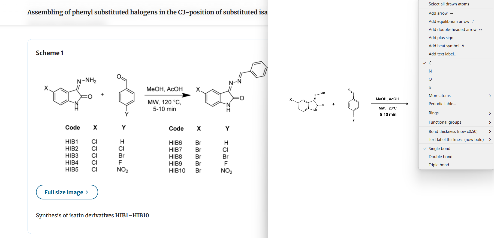

<p align="center">
  
</p>

<h1 align="center">ChemPad</h1>

<p align="center"><b>A Notepad for Chemistry</b></p>

<p align="center">
  Quickly Sketch Compounds and Reaction Scheme. No Buttons !!, Its You and Your Quest for New Compounds
</p>


---

## GUI

<p align="left"></p>


## Features

- ACS Style
- Mechanism Arrows, Lone Pairs and Amino Acids
- 3D Visualization within Canvas
- Color Substructure to your needs
- Draw atoms, single/double/triple bonds, chains and fused structures with the mouse
- Ring library (carbocycles, aromatic and saturated heterocycles, fused rings)
- Functional group library, attached to an atom straight from the right-click menu
- Formal charges, any element through the periodic table dialog
- Stereochemistry: R/S and E/Z labels, or wedge/dash bonds
- Reaction scheme tools: arrows, equilibrium arrows, plus signs, heat symbol, text labels
- Live canonical SMILES, copy and paste SMILES
- Energy minimisation of the whole drawing or a selection
- Export 3D SDF (MMFF94, UFF fallback), 2D PNG, and screenshots
- Save and reopen drawings as `.pad` files
- Black or white background, undo, box select, duplicate, move, resize and rotate

## Install

### Windows

Download the installer from SourceForge and run it:

[](https://sourceforge.net/projects/chempad/files/latest/download)

[](https://sourceforge.net/projects/chempad/files/latest/download)

### Linux

Deactivate conda (if running) before activating uv:

```
conda deactivate
conda deactivate
```

Clone the repository and install the requirements:

<!--
```
git clone https://github.com/Muzatheking12/ChemPad.git
cd ChemPad
python3 -m venv venv
source venv/bin/activate
pip install -r requirements.txt
python ChemPad.py
```
-->

```
git clone https://github.com/Muzatheking12/ChemPad.git
cd ChemPad
uv venv --python 3.12
```

Run ChemPad:

```
source .venv/bin/activate
uv sync
python ChemPad.py
```

To deactivate the ChemPad environment:

```
deactivate
```

### MacOS

```
git clone https://github.com/Muzatheking12/ChemPad.git
cd ChemPad
brew install uv
uv venv .venv --python 3.12
source .venv/bin/activate
uv sync
python ChemPad.py
```


## Project files

| File | Purpose |
|---|---|
| `ChemPad.py` | Application window and entry point |
| `chempad_widget.py` | `MolSketchWidget`, the embeddable PySide6 widget |
| `chempad_core.py` | Sketch engine: drawing, bonds, rings, groups, embedding |

## Use the widget in your own PySide6 app

```python
import sys
from PySide6 import QtWidgets
from chempad_widget import MolSketchWidget

app = QtWidgets.QApplication(sys.argv)
sketcher = MolSketchWidget()
sketcher.smilesChanged.connect(print)
sketcher.show()
sys.exit(app.exec())
```

```python
sketcher.smiles()                  # canonical SMILES
sketcher.mol()                     # RDKit Mol, 2D
sketcher.mol3d()                   # RDKit Mol, 3D with hydrogens
sketcher.set_smiles("CC(=O)Oc1ccccc1C(=O)O")
sketcher.export("sdf", "out.sdf")  # mol, sdf, smi, inchi, inchikey, pdb, xyz
```

The header of `chempad_widget.py` documents the python usage for QWidget.

## Mouse and keyboard

| Action | Control |
|---|---|
| Place atom, ring or group | Left-click empty space |
| Draw a bond or chain | Left-drag from an atom |
| Change an atom's element | Left-click the atom |
| Cycle bond order | Left-click a bond |
| Menu: atoms, rings, groups, bonds, stereo | Right-click |
| Box select | Right-drag |
| Move selection | Shift + left-drag |
| Resize selection | Ctrl+Shift + move mouse |
| Rotate selection | Ctrl+Alt + move mouse |
| Pan | Middle-button drag |
| Zoom | Mouse wheel |
| Reset view | Home |

| Shortcut | Action |
|---|---|
| Ctrl+C / Ctrl+V | Copy / paste SMILES |
| Ctrl+Z | Undo |
| Ctrl+A | Select all |
| Ctrl+X / Delete | Delete selection |
| Ctrl+D | Duplicate selection |
| Ctrl+M | Energy-minimise selection |
| Ctrl+H | Cycle stereo display |
| Ctrl+G | Atom letters black / coloured |
| Ctrl+B | Background black / white |
| Ctrl+S / Ctrl+O | Save / open `.pad` file |
| Ctrl+E | Export 3D SDF |
| Ctrl+Q | Save 2D image |
| Ctrl+P | Screenshot |
| Ctrl+W | Show all shortcuts |

## Contributors

Molecular Design Group, Dublin City University

Muzammil Kabier: muzammil.kabier2@mail.dcu.ie,
Anthony Chubb: anthony.chubb@dcu.ie,
Paul Clarke: paul.clarke@uia.no,
Darren Fayne: darren.p.fayne@dcu.ie

## Cite Us

Kabier, M.; Chubb, A.; Clarke, P; Fayne, D. ChemPad: A notepad for chemistry. https://github.com/Muzatheking12/ChemPad


